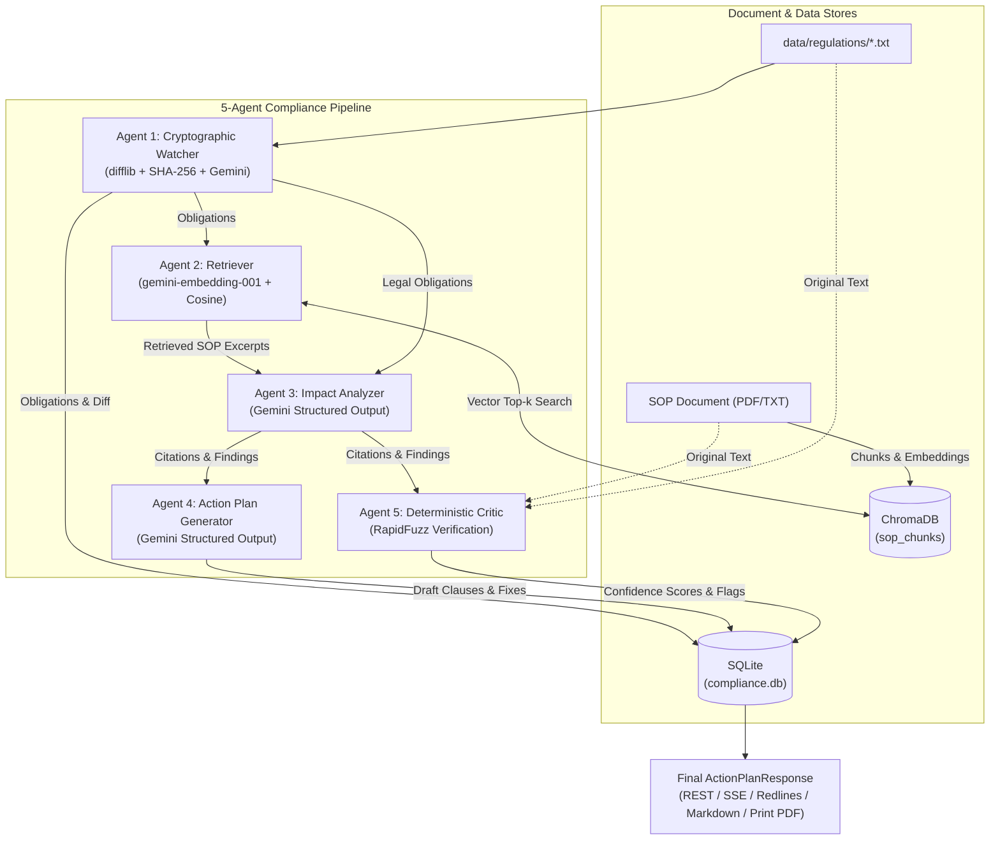

# LexGOV AI — Comprehensive Project Context Dossier

> **Purpose of this Document:**  
> This file contains the complete architectural, technical, functional, and implementation context of **LexGOV AI**. Use this document with Claude or any advanced reasoning model to draft high-precision prompts for future implementation cycles, feature additions, or production hardening.

---

## 1. Executive Summary

- **Product Name:** LexGOV AI (Enterprise Regulatory Intelligence System)
- **Target Audience:** Small and Medium Enterprises (SMEs) in Bangladesh navigating complex corporate regulatory compliance.
- **Core Problem:** Government bodies (such as the National Board of Revenue — NBR) issue Value Added Tax (VAT) statutory regulatory orders (SROs) and amendments. SMEs fail to detect discrepancies between new legal rules and their existing Standard Operating Procedures (SOPs), resulting in heavy statutory fines, blocked bank accounts, or litigation.
- **Solution:** An automated, synchronous **5-Agent Retrieval-Augmented Generation (RAG)** pipeline that:
  1. Diffs legal amendments and extracts binding obligations (Watcher).
  2. Embeds obligations and retrieves relevant SOP clauses from ChromaDB (Retriever).
  3. Detects gaps, conflicts, and outdated rules using structured JSON schemas (Impact Analyzer).
  4. Redlines SOP clauses and generates operational/software fix checklists (Action Plan Generator).
  5. Computes mathematical confidence scores and flags potential hallucinations using deterministic RapidFuzz matching (Critic / Verifier).
  6. Renders interactive word-level redline diffs (Track Changes, Side-by-Side, Clean) and exports audit-ready Markdown & PDF-printable reports.
  7. Provides continuous source monitoring, statutory deadline alerts, grounded AI compliance chat, team collaboration with RBAC, and scoped developer APIs.

---

## 2. Technology Stack & Environment

| Component | Technology | Version / Key Details |
|---|---|---|
| **OS & Host** | Windows 11 (64-bit) | PowerShell shell, UTF-8 environment |
| **Frontend Framework** | Next.js (App Router) | `16.2.12` with Turbopack, React `19.2.8` |
| **Frontend Language** | TypeScript | `5.x`, strict mode, Server Components + `'use client'` |
| **Styling & Icons** | Tailwind CSS + Lucide Icons | Tailwind `3.4.19`, custom shadows (`2xs`, `xs`), `lucide-react 1.16` |
| **Backend Framework** | FastAPI + Uvicorn | FastAPI `0.162.2`, Uvicorn `0.54.0` with `--factory` pattern |
| **Backend Language** | Python | Python `3.14.7` in virtual environment (`backend/.venv`) |
| **AI / LLM SDK** | Google GenAI SDK | `google-genai 3.0.0` (Client API, `types.GenerateContentConfig`) |
| **Primary LLM Model** | `gemini-3.5-flash` / `gemini-3.8-flash` | Flagship efficiency models with structured Pydantic outputs |
| **Embedding Model** | `gemini-embedding-001` | 768-dimensional task-optimized embeddings (MRL) |
| **Vector Database** | ChromaDB | `chromadb 1.5.9`, Persistent client, Cosine distance (`hnsw:space: cosine`) |
| **Deterministic Critic** | RapidFuzz | `rapidfuzz 3.14.6`, `partial_ratio_alignment` & `partial_ratio` |
| **Relational Database** | SQLite (Built-in) | Thread-safe connection with `check_same_thread=False`, mutex locks & FTS5 full-text virtual table (`schema_version = 7`) |
| **Authentication** | Supabase Auth + Local fallback | Asymmetric JWKS + HS256 JWT verification, JIT provisioning, `@supabase/ssr` cookies |
| **Document Parsing & OCR** | `pypdf 7.0` + `pypdfium2` + Gemini Vision | In-memory parser for digital PDFs; auto-routed Gemini Vision OCR for scanned/image-only PDFs |
| **Web & Portal Crawler** | Playwright (Chromium) | Headless browser crawler with SSRF route interception, robots.txt, domain allowlist, EN/BN candidate discovery |
| **Diff Engine** | Python `difflib` + TS LCS | Python `SequenceMatcher` for regulations; TypeScript word LCS for policy redlines |

---

## 3. Repository Architecture & File Directory

```
compliance/
├── start.ps1                                # One-click PowerShell script to boot frontend, backend & worker
├── README.md                                # Root system documentation & quickstart guide
├── PROJECT_CONTEXT.md                       # Comprehensive architectural & context dossier (this file)
├── .env                                     # Root environment variables
│
├── backend/
│   ├── requirements.txt                     # FastAPI, google-genai, chromadb, rapidfuzz, pypdf, pytest
│   ├── .env.example                         # Environment template with GEMINI_API_KEY
│   ├── .env                                 # Active backend environment variables (git-ignored)
│   ├── README.md                            # Backend-specific architecture & CLI instructions
│   ├── storage/                             # Persistent runtime data (compliance.db, ChromaDB vectors)
│   ├── app/
│   │   ├── __init__.py
│   │   ├── config.py                        # Settings dataclass loading from environment / .env
│   │   ├── schemas.py                       # Pydantic API models, auth, catalog, usage & LLM schemas
│   │   ├── db.py                            # SQLite versioned migrations (v1->v2->v3, 35 tables)
│   │   ├── auth.py                          # Zero-dependency scrypt hashing, sessions & timing-safe checks
│   │   ├── plans.py                         # Single source of truth: 4 plans, 23 capabilities, 6 metrics
│   │   ├── entitlements.py                  # Capability checks, AnalysisOptions tiering & retention cutoffs
│   │   ├── usage.py                         # Two-phase reserve/commit/release usage metering & window logic
│   │   ├── subscriptions.py                 # Subscription lifecycle: free provisioning, upgrades, cancellations
│   │   ├── cli.py                           # Management CLI: create-user, set-plan, purge-expired
│   │   ├── billing/                         # Billing port/adapter: BillingProvider Protocol + MockBillingProvider
│   │   ├── feature_options.py               # Tunable constants & level-dependent options
│   │   ├── verification.py                  # Pure RapidFuzz deterministic quotation & snippet verification
│   │   ├── ports.py                         # Abstract Protocols (Clock, Notifier, SourceFetcher, LLM)
│   │   ├── adapters.py                      # Implementations (InAppNotifier, ConsoleNotifier, UrlPollAdapter, SystemClock)
│   │   ├── worker.py                        # Background job runner (atomic leases, exponential backoff, dead-letter)
│   │   ├── crawler.py                       # Playwright headless crawler with SSRF route interception & robot checks
│   │   ├── ocr.py                           # Scanned PDF OCR engine (Gemini Vision + Tesseract fallback)
│   │   ├── legal_library/                   # Autonomous Bangladesh Legal Library ingestion engine
│   │   │   ├── __init__.py
│   │   │   ├── extraction.py                # Dual-path extractor (pypdf/OCR) + SHA-256 version hasher
│   │   │   ├── structuring.py               # Structured output clause splitter with heuristic fallback & ratio checks
│   │   │   ├── classifier.py                # Controlled vocabulary domain tagger & relation extractor
│   │   │   ├── verifier.py                  # RapidFuzz zero-hallucination critic verifier for legal summaries
│   │   │   ├── change.py                    # Section-by-section diffing & watcher alert dispatcher
│   │   │   ├── discovery.py                 # Crawler integration for official law sources (BGPress, MinLaw, etc.)
│   │   │   └── pipeline.py                  # Orchestrator with auto-publish policy & ChromaDB/FTS indexing
│   │   ├── news.py                          # Public & sector-specific regulatory news feeds
│   │   ├── monitoring.py                    # SSRF-guarded poller, diff detector, and change manager
│   │   ├── deadlines.py                     # Statutory due-dates & regulation-derived deadline extractor
│   │   ├── assistant.py                     # Grounded compliance assistant SSE streaming & injection guards
│   │   ├── collaboration.py                 # RBAC, invites, finding reviews, adjusted impact scoring
│   │   ├── api_v1.py                        # Scoped Bearer API key endpoints (/api/v1)
│   │   ├── support.py                       # Plan-prioritized support ticketing
│   │   ├── llm.py                           # GeminiClient wrapper (retries, structured output, embeddings)
│   │   ├── documents.py                     # Document parser & section-aware heading chunker
│   │   ├── vectorstore.py                   # VectorStore wrapper around ChromaDB persistent collection
│   │   ├── regulations.py                   # RegulationPair loader, line diffing & SHA-256 version hash
│   │   ├── starter.py                       # Start Fresh wizard rule engine & starter SOP generator
│   │   ├── services.py                      # Service container passed to routes and agent pipeline
│   │   ├── agents.py                        # Implementation of all 5 compliance agents
│   │   ├── pipeline.py                      # Synchronous orchestrator yielding real-time SSE progress
│   │   ├── report.py                        # Markdown audit report builder with tier formatting
│   │   └── main.py                          # FastAPI application factory (REST + SSE endpoints, auth & gates)
│   ├── data/
│   │   ├── regulations/
│   │   │   ├── regulation_before.txt        # NBR VAT SRO 4.2 (2024 edition — 30 days, no named officer)
│   │   │   └── regulation_after.txt         # NBR VAT SRO 4.2 (2025 edition — 15 days, designated officer, fines)
│   │   └── samples/
│   │       └── apex_logistics_sop.txt       # Apex Logistics Bangladesh Ltd. non-compliant financial SOP
│   └── tests/
│       ├── __init__.py
│       ├── conftest.py                      # Deterministic offline FakeLLM fixture & test client setup
│       ├── test_api.py                      # 7 core API & pipeline integration tests
│       ├── test_auth_wall.py                # 8 mandatory auth wall, anti-enumeration & IDOR tests
│       ├── test_crawler.py                  # 8 Playwright crawler tests (caps, SSRF guard, robots.txt)
│       ├── test_ocr.py                      # 4 OCR engine tests (Gemini Vision / Tesseract / pypdfium2)
│       ├── test_legal_library_models.py     # 1 Schema v5 CRUD, FTS5 & coverage tests
│       ├── test_legal_library_pipeline.py   # 5 Legal Library multi-agent pipeline tests
│       ├── test_legal_library_api.py        # 11 Legal Library REST/admin integration tests
│       ├── test_phase2_slices.py            # 18 Phase 2 feature slice tests (news, monitoring, worker, deadlines, etc.)
│       ├── test_starter.py                  # 5 Start Fresh rule engine & starter SOP tests
│       └── test_subscriptions.py            # 10 golden drift, matrix, quota 429, concurrency & IDOR tests
│
├── docs/
│   ├── auth-wall-checklist.md               # Mandatory authentication wall checklist and verification record
│   └── adr/
│       ├── 0001-subscriptions-and-entitlements.md # Architecture decision record for subscription engine
│       ├── 0002-phase2-features.md          # Architecture decision record for Phase 2 vertical features
│       └── 0003-legal-library.md            # Architecture decision record for Bangladesh Legal Library
│
└── frontend/
    ├── package.json                         # Next.js 16, React 19, Tailwind, Lucide, ESLint
    ├── tailwind.config.ts                   # Tailwind config with custom shadows and spacing
    ├── postcss.config.js                    # Tailwind v3 PostCSS configuration
    ├── tsconfig.json                        # Path aliases (`@/*` -> `./src/*`)
    ├── eslint.config.mjs                    # Next.js vitals + TypeScript flat config
    ├── vercel.json                          # Vercel deployment spec
    ├── README.md                            # Frontend usage guide
    └── src/
        ├── proxy.ts                         # Next.js 16 edge session-based route protection proxy
        ├── app/
        │   ├── layout.tsx                   # Root HTML shell
        │   ├── globals.css                  # Tailwind directives, clean scrollbar, and @media print rules
        │   ├── (public)/                    # Route group for unauthenticated visitors
        │   │   ├── layout.tsx               # Centered minimal shell (zero protected chrome)
        │   │   ├── login/page.tsx           # Anti-enumeration sign-in with 5-attempt rate limit
        │   │   └── signup/page.tsx          # User registration + automatic free workspace provisioning
        │   └── (app)/                       # Route group for authenticated workspace users
        │       ├── layout.tsx               # Server-fetched MeResponse shell, Navbar, UpgradeModal, Footer
        │       ├── page.tsx                 # Executive Dashboard & workflow overview
        │       ├── upload/page.tsx          # SOP Ingestion: PDF/TXT upload or Start Fresh wizard
        │       ├── regulations/page.tsx     # Cryptographic regulatory before/after diff comparison viewer
        │       ├── laws/                    # Bangladesh Legal Library
        │       │   ├── page.tsx             # Server-rendered catalog with filters, coverage strip, and recommendations
        │       │   ├── LawsClient.tsx       # Interactive search & filter UI
        │       │   ├── [id]/page.tsx        # Section-by-section law reader, EN/BN toggle, official source link
        │       │   ├── [id]/LawDetailClient.tsx # Grounded Q&A drawer, SOP analysis trigger, watchlist toggle
        │       │   ├── [id]/diff/page.tsx   # Redline diff comparing statutory editions
        │       │   ├── [id]/diff/LawDiffClient.tsx # Clause-level additions/modifications/deletions
        │       │   ├── coverage/page.tsx    # Live coverage stats & monitored sources dashboard
        │       │   └── coverage/CoverageClient.tsx # Breakdown charts and ingestion history
        │       ├── admin/laws/page.tsx      # Admin review queue, source toggles, manual document upload
        │       ├── analysis/page.tsx        # Multi-agent live SSE progress tracker with quota checks
        │       ├── action-plan/[id]/        # Executive audit report: risk score, verified findings, redlines
        │       │   ├── page.tsx             # Server Component loading plan & initial reviews
        │       │   └── ActionPlanClient.tsx # Interactive redlines, finding reviews, comments, and print/PDF
        │       ├── assistant/page.tsx       # Grounded conversational AI compliance assistant (SSE stream)
        │       ├── monitoring/page.tsx      # Source monitoring subscriptions & diff alert manager
        │       ├── news/page.tsx            # Curated Bangladesh regulatory news & SRO circulars
        │       ├── notifications/page.tsx   # User notification inbox and preference center
        │       ├── team/page.tsx            # Team collaboration, seat limits, invitations & RBAC
        │       ├── settings/api-keys/page.tsx # Scoped Bearer API keys management
        │       ├── support/page.tsx         # Plan-prioritized support ticket portal
        │       ├── admin/page.tsx           # Platform administration & background job queue depth
        │       ├── pricing/page.tsx         # 4-tier interactive pricing matrix dynamically loaded from API
        │       └── account/page.tsx         # Workspace subscription management & 6 real-time usage meters
        ├── components/
        │   ├── Navbar.tsx                   # Responsive header with desktop nav & mobile hamburger drawer
        │   ├── LegalDisclaimer.tsx          # Standard and compact legal notice components
        │   ├── BackendStatus.tsx            # Live banner checking backend reachability and API key state
        │   ├── FeatureGate.tsx              # Component-level capability gate with upgrade modal trigger
        │   ├── UpgradeModal.tsx             # Interactive checkout & upgrade dialog
        │   ├── PlanBadge.tsx                # Visual plan tier indicator pill
        │   ├── UsageMeter.tsx               # Usage gauge bar with reset dates
        │   ├── StartFreshWizard.tsx         # 9-question launch questionnaire for SMEs without SOPs
        │   └── RedlineDiffViewer.tsx        # Interactive Myers/LCS word diff (Track Changes, Split, Clean)
        ├── context/
        │   └── AuthContext.tsx              # Client AuthContext provider (user, workspace, capabilities, limits)
        └── lib/
            ├── types.ts                     # TypeScript interfaces matching backend models & SSE events
            ├── api.ts                       # Typed fetch client + ReadableStream SSE consumer
            └── session.ts                   # SessionStorage helper for tracking active company/doc IDs
```

---

## 4. The 5-Agent Compliance Pipeline: Deep Dive



### Agent 1 — Cryptographic Regulatory Watcher
- **Inputs:** `regulation_before.txt` and `regulation_after.txt`.
- **Deterministic Step:** Computes SHA-256 digest over both documents combined; performs `difflib.SequenceMatcher` to generate line-by-line diff (`equal`, `removed`, `added`).
- **AI Step:** Sends both texts and the unified diff to Gemini with `WatcherLLMOutput` schema.
- **Output:**
  - `title`: Short title (e.g. `NBR VAT SRO Clause 4.2`).
  - `change_summary`: 2–4 sentence plain-language summary of what changed.
  - `change_type`: `amendment` | `new_obligation` | `repeal` | `clarification`.
  - `changed_clauses`: String array of before-vs-after clause comparisons.
  - `obligations`: String array of testable corporate duties.
- **Caching:** Keyed by `{version_hash}:{model_name}` in SQLite table `watcher_results`. Instant response on subsequent runs.

### Agent 2 — Vector Retriever
- **Inputs:** Array of extracted obligations from Agent 1, plus `document_id`.
- **AI Step:** Computes dense vector embeddings for all obligations in one batch using `gemini-embedding-001` (`task_type="RETRIEVAL_QUERY"`, 768 dimensions).
- **Vector Step:** Performs top-$k$ nearest-neighbor search (`k=4`) against ChromaDB collection `sop_chunks` filtered by `{"document_id": document_id}`.
- **Output:** Deduplicated list of relevant SOP chunks sorted by lowest cosine distance.

### Agent 3 — Impact Analyzer
- **Inputs:** Company metadata (name, industry, country), Watcher summary, extracted obligations, full revised regulation text, and retrieved SOP excerpts.
- **AI Step:** Evaluates conflicts with Gemini using `AnalyzerLLMOutput` schema.
- **Output:**
  - `impact_score`: Integer (0–100, clamped).
  - `urgency`: `low` | `medium` | `high` | `critical`.
  - `findings`: Array of:
    - `issue`: Concise title.
    - `issue_type`: `gap` (silent on mandatory rule) | `conflict` (directly contradicts rule) | `outdated_reference` (cites old deadlines/laws).
    - `severity`: `low` | `medium` | `high`.
    - `explanation`: Detailed legal and operational risk.
    - `citation_source`: `'sop'` | `'regulation'`.
    - `citation_section`: Section label from context.
    - `citation_text_snippet`: Verbatim quotation.

### Agent 4 — Action Plan Generator
- **Inputs:** Company profile, Watcher summary, findings from Agent 3, retrieved SOP excerpts.
- **AI Step:** Prompts Gemini using `GeneratorLLMOutput` schema.
- **Output:**
  - `policy_draft`: Array of rewritten SOP clauses in formal policy language retaining the original section numbering.
  - `technical_fixes`: Array of actionable operational and IT checklist tasks (calendar alerts, ERP configuration, appointing officers, training).

### Agent 5 — Deterministic Critic / Verifier
- **Design Philosophy:** **Zero LLM reliance.** Prevents hallucinations using strict mathematical string alignment.
- **Inputs:** All findings from Agent 3, chunked full text of the uploaded SOP, chunked text of before/after regulations.
- **Algorithm:**
  1. Searches candidate source chunks using `rapidfuzz.fuzz.partial_ratio`.
  2. Identifies the best candidate chunk and extracts the exact substring boundary using `rapidfuzz.fuzz.partial_ratio_alignment`.
  3. Expands the boundary outward to whole word delimiters.
  4. Replaces the AI-generated snippet with the verified source span.
  5. Computes a confidence score ($0.00$ to $1.00$).
  6. If confidence is below `REVIEW_THRESHOLD` (default: `0.75`), sets `flagged_for_review: true`.
- **Output:** Verified, tamper-proof citations with mathematical proof of existence.

---

## 5. Subscription & Entitlement Engine (Phase 1)

### 4-Tier Plan Catalog (`app/plans.py`)
- **Free (৳0/mo):** 9-question launch questionnaire, general policy recommendations, basic company profile, 1 seat.
- **Starter (৳999/mo):** SOP upload & indexing, 10 detailed analyses/mo, 5 SOP documents, basic personalized checklist, markdown report export, 30-day retention, 1 seat.
- **Growth (৳2,999/mo):** 50 detailed analyses/mo, 25 SOP documents, full policy drafts, technical operational fixes, source monitoring (5 sources), 3 seats, 365-day retention.
- **Professional (৳7,999/mo):** 200 detailed analyses/mo, 100 SOP documents, advanced technical recommendations & risk scoring, 20 monitored sources, 10 seats, 1,095-day retention, priority support, API integrations.

### Two-Phase Usage Metering (`app/usage.py`)
- All quota-consuming actions execute via a two-phase `reserve -> commit / release` transaction:
  - If quota is exhausted, raises HTTP 429 `QUOTA_EXCEEDED` with upgrade prompt.
  - If analysis fails midway, reserved quota is automatically released back to the workspace.

---

## 6. Phase 2 Vertical Capabilities & Architecture

1. **Transactional Job Queue (`app/worker.py`):**
   - SQLite-safe transactional lease locking (`lease_until < now`).
   - Exponential backoff (`base_delay * 2 ** attempts`). Poison-pill quarantine to `dead_letter` after 5 failed attempts.
   - Long-running daemon (`python -m app.worker`) and one-shot execution (`python -m app.worker --once`) for cron integration.
2. **SSRF-Guarded Source Monitoring (`app/monitoring.py`):**
   - `UrlPollAdapter` restricts protocol to HTTP/HTTPS, resolves DNS, blocks private/loopback/cloud metadata IP ranges (RFC 1918, 127.0.0.0/8, 169.254.169.254), pins resolved IP, and caps body size at 5 MB.
3. **Statutory Deadlines & Alerts (`app/deadlines.py`):**
   - Automatically derives compliance filing deadlines from published regulations and tracks custom company deadlines with reminder notifications (14, 7, 1 day lead time).
4. **Grounded AI Compliance Assistant (`app/assistant.py`):**
   - Conversational agent grounded in vector-retrieved SOP clauses and official regulations.
   - Anti-injection isolation delimiters prevent system prompt tampering. Real-time SSE streaming.
5. **Team Collaboration & Human-in-the-Loop Reviews (`app/collaboration.py`):**
   - Role-based permissions: Owner, Admin, Member, Viewer.
   - Finding Reviews: Compliance officers can approve, edit, or reject Agent 3 findings, triggering automatic mathematical re-calculation of the overall `impact_score`.
   - Discussion threads / comments on findings and checklist items.
6. **Scoped Developer API (`app/api_v1.py`):**
   - Scoped Bearer API keys under `/api/v1` with SHA-256 key hashing, prefix disclosure only, and 60 req/min rate limiting.
7. **Plan-Prioritized Support Ticketing (`app/support.py`):**
   - In-app support tickets automatically prioritized by subscription tier (Standard, Priority, Urgent).

---

## 7. Interactive Policy Redlines & Audit PDF / Print Engine

### Redline Diff Component (`RedlineDiffViewer.tsx`)
- Computes fine-grained word-by-word Longest Common Subsequence (LCS) diffs between original SOP text snippets and Agent 4's drafted clauses.
- **Three Viewing Modes:**
  1. **Track Changes (Inline Redline):** Shows deletions with red strikethrough (`<del>`) and additions with emerald highlighting (`<ins>`).
  2. **Side-by-Side Comparison:** 2-column comparative layout (Original SOP on left, Amended Policy on right).
  3. **Clean Policy Draft:** Clean final clause ready for deployment with a 1-click "Copy Clause" clipboard button.
- **Dynamic Source Selection:** Allows comparing against any verified citation from the findings report.
- **Word Metrics:** Live word counter (+added, -removed, total).

### Audit PDF / Print Engine (`globals.css` + `ActionPlanClient.tsx`)
- One-click "Print Report (PDF)" button triggering native browser print and "Save as PDF".
- Dedicated `@media print` rules stripping navigation, action buttons, and comment input fields.
- Official **Statutory Compliance Verification Statement & Signatory Block**:
  - Verification statement referencing Bangladesh Value Added Tax & Supplementary Duty Act 2012.
  - Plan ID and SHA-256 version integrity hash.
  - Deterministic RapidFuzz protocol verification stamp.
  - Timestamp in Bangladesh Standard Time (BST).
  - Corporate Sign-Off line with seal block for the Authorized Compliance Officer and Managing Director.

---

## 8. Relational Database Schema (`schema_version = 3`)

SQLite database `backend/storage/compliance.db` holds **35 tables**:
- **Identity & Tenancy:** `users`, `workspaces`, `memberships`, `sessions`, `invites`, `activity_events`
- **Subscriptions & Metering:** `subscriptions`, `subscription_events`, `usage_counters`, `usage_events`, `webhook_events`
- **Compliance Core:** `documents`, `company_profiles`, `watcher_results`, `action_plans`, `checklist_items`
- **Regulatory Intelligence:** `regulations`, `regulation_versions`, `regulation_sources`, `regulatory_changes`, `news_items`
- **Source Monitoring & Deadlines:** `monitor_subscriptions`, `deadlines`, `reminder_log`
- **Messaging & Outbox:** `notifications`, `notification_preferences`, `outbox`, `jobs`
- **AI Assistant:** `assistant_threads`, `assistant_messages`
- **Collaboration & Support:** `comments`, `finding_reviews`, `api_keys`, `support_tickets`

---

## 9. API Endpoint Reference

### Public Routes (`public_router`)
- `POST /api/auth/signup`: Create user and provision initial free workspace.
- `POST /api/auth/login`: Session authentication with generic anti-enumeration error.
- `GET /api/health`: Health probe returning `{"status": "ok"}` (zero secret leakage).

### Protected Routes (`protected_router` — Requires `complianceos_session` cookie)
- `POST /api/auth/logout`: Revoke active session token.
- `GET /api/me`: Current user, workspace role, plan ID, 23 capability objects, and 6 usage meters.
- `GET /api/plans`: Dynamic plan catalog, pricing in BDT, limits, and capability matrix.
- `GET /api/usage`: Current workspace usage counters.
- `POST /api/billing/checkout`: Generate upgrade checkout session.
- `POST /api/billing/webhook`: Inbound webhook listener for billing lifecycle events.
- `POST /api/subscription/cancel`: Cancel subscription at period end.
- `POST /api/subscription/change`: Switch plan tier.
- `GET /api/checklist` & `PATCH /api/checklist/{item_id}`: SME compliance checklist items.
- `POST /api/company-profile`: Update company profile metadata.
- `POST /api/documents/upload`: Ingest user SOP document (PDF or TXT) into ChromaDB.
- `POST /api/documents/sample`: 1-click indexing of sample Apex Logistics SOP.
- `POST /api/starter-guide` & `POST /api/starter-guide/sop`: Start Fresh rule engine and starter SOP generator.
- `GET /api/regulations`: Multi-regulation statutory catalog summary list (version counts, obligation counts, sector metadata).
- `GET /api/regulations/{id}`: Detailed regulation record, version pair (before/after texts), and latest change summary.
- `POST /api/regulations/{id}/detect-change`: Run Agent 1 Watcher for any specific statutory act.
- `GET /api/regulations/current`: Backwards-compatible endpoint for NBR VAT SRO 4.2 texts and version hash.
- `POST /api/regulations/detect-change`: Backwards-compatible default Watcher diff and obligation extraction.
- `POST /api/analyze`: Synchronous full 5-agent pipeline execution (accepts optional `regulation_id`).
- `POST /api/analyze/stream`: Real-time Server-Sent Events (SSE) streaming progress (accepts optional `regulation_id`).
- `GET /api/action-plans/{plan_id}`: Retrieve structured audit action plan by ID.
- `GET /api/action-plans/{plan_id}/report`: Download tier-formatted Markdown report (`.md`).
- `GET /api/news`: Public and sector-specific regulatory news feeds.
- `GET /api/notifications` & `PATCH /api/notifications/{id}/read`: User notification center.
- `GET /api/monitoring/sources` & `GET /api/monitoring/subscriptions`: Source monitoring subscriptions.
- `POST /api/monitoring/subscriptions` & `DELETE /api/monitoring/subscriptions/{id}`: Manage monitor sources.
- `GET /api/deadlines` & `POST /api/deadlines` & `PATCH /api/deadlines/{id}` & `DELETE /api/deadlines/{id}`: Compliance dates.
- `POST /api/assistant/ask`: Grounded conversational compliance assistant (SSE stream).
- `GET /api/assistant/threads` & `GET /api/assistant/threads/{id}/messages`: Assistant chat history.
- `GET /api/team/members` & `PATCH /api/team/members/{id}` & `DELETE /api/team/members/{id}`: Team members & roles.
- `GET /api/team/invites` & `POST /api/team/invites` & `DELETE /api/team/invites/{id}`: Team invites.
- `POST /api/team/invites/accept`: Accept team invite token.
- `GET /api/comments` & `POST /api/comments`: Resource discussion threads.
- `GET /api/finding-reviews` & `POST /api/finding-reviews`: Finding status reviews (approve/reject/edit).
- `GET /api/settings/api-keys` & `POST /api/settings/api-keys` & `DELETE /api/settings/api-keys/{id}`: API keys.
- `GET /api/support/tickets` & `POST /api/support/tickets`: Customer support tickets.
- `GET /api/laws`: Filtered statutory enactments catalog (supports `q`, `law_type`, `domain_tag`, `status`, `year`).
- `GET /api/laws/coverage`: Transparent library coverage metrics, source counts, and 0-claim notice.
- `GET /api/laws/search`: Hybrid RRF search (FTS5 + ChromaDB) with exact section boost.
- `GET /api/laws/recommended`: Sector-matched statutory recommendations.
- `GET /api/laws/watchlist` & `POST /api/laws/{id}/watch` & `DELETE /api/laws/{id}/watch`: User watchlist.
- `GET /api/laws/{id}` & `GET /api/laws/{id}/sections` & `GET /api/laws/{id}/diff`: Law details, structured clauses, and redline diffs across editions.
- `POST /api/laws/ask`: Grounded statutory Q&A with RapidFuzz verified citations.
- `POST /api/laws/{id}/analyze`: Benchmark customer SOP against statutory enactment using the 5-agent pipeline.
- `GET /api/admin/laws/review-queue` & `POST /api/admin/laws/{id}/approve` & `POST /api/admin/laws/{id}/reject`: Human review queue.
- `GET /api/admin/laws/sources` & `PATCH /api/admin/laws/sources/{id}`: Government source configuration.
- `POST /api/admin/laws/upload`: Manual PDF/TXT gazette ingestion into pipeline.
- `POST /api/admin/laws/ingest/run`: Trigger routine discovery crawl.

---

## 10. Verification & Quality Health

- **Backend Automated Tests:** 81/81 passed (`pytest -q`).
  - `test_api.py`: 8 tests
  - `test_auth_wall.py`: 10 tests (including Supabase JWT asymmetric JWKS/symmetric HS256 validation & JIT user provisioning)
  - `test_crawler.py`: 8 tests (depth/page caps, SSRF route interception, robots.txt, changed-hash detection, portal_crawler capability gating)
  - `test_ocr.py`: 4 tests (image-only PDF routing, GeminiVision/Tesseract OCR, meter quota)
  - `test_legal_library_models.py`: 1 test (schema v5 CRUD, FTS5 virtual table, watchlist & review queue)
  - `test_legal_library_pipeline.py`: 5 tests (heuristic splitting, RapidFuzz verifier matching & hallucination defense, auto-publish policy, watcher alerts)
  - `test_legal_library_api.py`: 11 tests (listing, coverage stats, hybrid search, recommendations, watchlist, details/sections/diff, ask, analyze, admin queue & sources, capability gating)
  - `test_phase2_slices.py`: 18 tests
  - `test_starter.py`: 5 tests
  - `test_subscriptions.py`: 11 tests (including schema_version 5 migration)
- **Frontend Linter:** `npm run lint` -> 0 errors.
- **Frontend Build:** `npm run build` -> Compiles clean in Turbopack across all 22 static & dynamic routes.

---

## 11. Priority Roadmap Objectives for Future Claude Cycles

When prompting Claude for future feature additions or hardening, target any of these high-value tasks:

1. **[COMPLETED] Multi-Regulation Library & Dynamic Ingestion:**
   - Seeded statutory acts (`nbr-vat-sro-4.2`, `bangladesh-labor-act-2023`, `income-tax-act-2023`).
   - Dynamic `RegulationPair` loader with SQLite version pair storage and Agent 1/3/5 multi-regulation pipeline routing.
   - Interactive statutory catalog page (`/regulations`), target regulation dropdown on `/upload`, and workspace context preservation into `/analysis`.
2. **[COMPLETED] Government Website Crawler, Scanned PDF OCR & Supabase Auth:**
   - **Crawler:** Headless Chromium crawler with Playwright, SSRF request interception, same-domain scoping, robots.txt compliance, English/Bengali candidate link discovery, and worker lease/backoff background execution gated by `portal_crawler` capability.
   - **OCR:** Scanned/image-only gazette & SOP PDF text extraction via Gemini Vision with pypdfium2, Tesseract fallback, two-phase `ocr_pages` usage metering, schema_version 4 additive columns, and RapidFuzz OCR review badges.
   - **Supabase Auth:** Asymmetric JWKS and HS256 JWT verification, JIT workspace/user provisioning, Next.js 16 Server Components & `@supabase/ssr` edge session synchronization.
3. **[COMPLETED] Bangladesh Legal Library & Autonomous Ingestion Engine:**
   - Multi-agent ingestion pipeline (`ExtractionAgent`, `StructuringAgent`, `ClassifierAgent`, `VerifierAgent`, `ChangeAgent`, `DiscoveryAgent`, `LegalIngestionPipeline`).
   - Hybrid RRF Search (SQLite FTS5 + ChromaDB `law_sections` with exact section number boost).
   - Zero-hallucination RapidFuzz Critic for AI summaries and statutory Q&A citations.
   - Auto-publish policy with human review queue for low-confidence OCR or verifier discrepancies.
   - Next.js 16 Server Components & interactive client UI (`/laws`, `/laws/[id]`, `/laws/[id]/diff`, `/laws/coverage`, `/admin/laws`).
   - Full 5-agent SOP benchmarking connection (`POST /api/laws/{id}/analyze`).
4. **Automated Webhook & Slack/WhatsApp Dispatcher:**
   - Dispatch urgent NBR regulatory change notifications and deadline reminders directly to SME founder channels (Slack incoming webhooks, WhatsApp Business API).
5. **Background Worker Production Daemonizing:**
   - Configure a Windows Service wrapper or Dockerized worker definition ensuring `app.worker` runs reliably in the background alongside Uvicorn.
6. **Client-Side PDF Binary Export:**
   - Implement binary `.pdf` file generation (e.g., using `@react-pdf/renderer`) to supplement the native browser print/PDF functionality.
   - **Crawler:** Headless Chromium crawler with Playwright, SSRF request interception, same-domain scoping, robots.txt compliance, English/Bengali candidate link discovery, and worker lease/backoff background execution gated by `portal_crawler` capability.
   - **OCR:** Scanned/image-only gazette & SOP PDF text extraction via Gemini Vision with pypdfium2, Tesseract fallback, two-phase `ocr_pages` usage metering, schema_version 4 additive columns, and RapidFuzz OCR review badges.
   - **Supabase Auth:** Asymmetric JWKS and HS256 JWT verification, JIT workspace/user provisioning, Next.js 16 Server Components & `@supabase/ssr` edge session synchronization.
3. **Automated Webhook & Slack/WhatsApp Dispatcher:**
   - Dispatch urgent NBR regulatory change notifications and deadline reminders directly to SME founder channels (Slack incoming webhooks, WhatsApp Business API).
4. **Background Worker Production Daemonizing:**
   - Configure a Windows Service wrapper or Dockerized worker definition ensuring `app.worker` runs reliably in the background alongside Uvicorn.
5. **Client-Side PDF Binary Export:**
   - Implement binary `.pdf` file generation (e.g., using `@react-pdf/renderer`) to supplement the native browser print/PDF functionality.
6. **Administrative Ingestion Portal for Custom Regulatory Laws:**
   - UI for compliance officers to paste or upload full statutory gazettes/SROs, compute cryptographic diffs against prior versions, and add them to the company's active benchmark library.

---

## 12. Prompting Rules & Conventions for Claude / Antigravity

When asking Claude to write code or modify files for LexGOV AI:
- **Paths:** Always use absolute Windows paths (`d:\compliance\backend\...` or `d:\compliance\frontend\...`).
- **Next.js 16 Rules:** This repository runs Next.js 16 + React 19 (App Router). Never use client `useEffect` for data-fetching or state-setting that triggers cascading re-renders. Use Server Components or direct user actions.
- **Python Conventions:** Compatible with Python 3.12+ (type unions `str | None`, explicit dataclasses, Pydantic v2).
- **Zero Hallucination Rule:** Citations and quotations must be verified through `app.verification` RapidFuzz matching.
- **Verification Rule:** Every code modification turn MUST conclude with running `npm run build` / `npm run lint` in `frontend` and `pytest -q` in `backend`.
